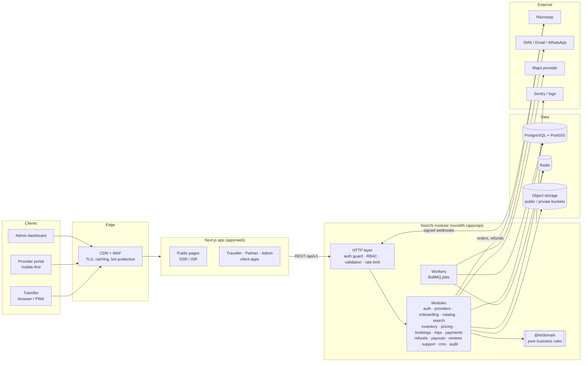

# 02 · System architecture

## Technology decisions

| Concern | Choice | Why / notes |
|---|---|---|
| Repo | pnpm workspace monorepo | One lockfile, shared domain package, atomic changes across web/API |
| Frontend | Next.js 16 (App Router), React 19, TypeScript, Tailwind CSS 4 | SSR/ISR for SEO-critical destination pages; RSC keeps public pages light |
| Forms & validation | React Hook Form + Zod 4 | **Same Zod schemas** validate in the browser and the API (`@kt/domain/schemas`) |
| Data fetching | TanStack Query (client), `fetch` in RSC | Cache + retries for app/portal screens |
| Motion | GSAP + ScrollTrigger (storytelling), Motion (`motion/react`) for UI, Lenis (desktop public pages only) | See [08](08-design-system.md) motion rules |
| Backend | NestJS 12 (ESM), modular monolith, REST + OpenAPI | Clear module boundaries, DI, guards; extract services later only if scale demands |
| TypeScript | 6.0 (not 7.0) | TS 7's native compiler is new; Nest relies on `emitDecoratorMetadata`. Re-evaluate in Phase 9 |
| ORM | Prisma 7.10 (stable) with `@prisma/adapter-pg` | `latest` npm tag currently points at an 8.0 RC — deliberately not used |
| Database | PostgreSQL 17 + PostGIS 3.5 | Geo search, exclusion constraints (`btree_gist`), `citext`, `pg_trgm` |
| Cache / locks / queues | Redis 7 + BullMQ (Phase 5+) | Rate limits, short-lived caches, background jobs (hold expiry, notifications, payouts) |
| Object storage | S3-compatible (AWS S3 `ap-south-1`; Adobe S3Mock locally) | Separate **public** (listing media) and **private** (KYC) buckets; private reads only via short-lived signed URLs |
| Payments | Razorpay (behind `PaymentGateway` interface) | UPI/cards/netbanking; orders + signature verification + webhooks; Route for split settlements evaluated in Phase 6 |
| Messaging | `MessageSender` abstraction (MSG91/Twilio SMS with DLT templates, SES email, WhatsApp BSP later) | Console sender for development only — config validation forbids it in staging/production |
| Maps | `MapProvider` abstraction (Google Maps Platform or Mappls) | Distances/routes come from the provider at quote time; never invented |
| Auth | Phone OTP + email/password; JWT access (15 min) + rotating opaque refresh token (httpOnly cookie) | Refresh-token reuse revokes the whole session family |
| Tests | Vitest (unit/integration), Playwright (E2E), axe (a11y), Lighthouse CI (perf) | |
| Observability | pino structured logs with request IDs, Sentry (errors), OpenTelemetry traces (Phase 9) | |

Changes to these choices must be recorded here with the reason before implementation.

## High-level architecture



### Request path for a booking (simplified)

```mermaid
sequenceDiagram
  participant U as Traveller
  participant W as Web
  participant A as API
  participant DB as Postgres
  participant G as Razorpay
  U->>W: Choose service, dates, party
  W->>A: POST /bookings/quote
  A->>DB: load price plan, rules, taxes
  A-->>W: line-itemised quote (server computed)
  U->>W: Continue to pay
  W->>A: POST /trips/{id}/checkout (Idempotency-Key)
  A->>DB: BEGIN; lock inventory rows; check availability; insert holds; booking → awaiting_payment; COMMIT
  A->>G: create order (amount from DB, not client)
  A-->>W: order id, hold expiry
  U->>G: pays (UPI / card)
  G-->>W: payment id + signature
  W->>A: POST /payments/verify
  A->>A: verify HMAC signature server-side
  G-->>A: webhook payment.captured (signed)
  A->>DB: idempotently: payment captured → holds committed → booking confirmed → settlement row
  A-->>U: confirmation + QR (via notifications worker)
```

## Module boundaries (backend)

Each module owns its tables and exposes services; other modules call those services, never each other's tables directly (enforced by review and, later, lint rules).

| Module | Owns | Depends on |
|---|---|---|
| `auth` | sessions, otp_verifications | users, messaging |
| `users` | users, user_profiles, saved_travellers, emergency_contacts | — |
| `rbac` | roles, permissions, role_permissions, user_roles | `@kt/domain/rbac` |
| `providers` / `provider-onboarding` | providers, provider_members, provider_categories, provider_destinations, verification events, payout accounts | documents, catalog, audit |
| `documents` | document_types, document_requirements, provider_documents, media_assets (private) | storage |
| `catalog` (destinations, categories, cms) | destinations, attractions, categories, destination_categories, cms_pages, faqs, banners | media |
| `services` (listings) | services, service_media, service_locations, tags, service_review_events, cancellation_policies | providers, catalog |
| `inventory` / `availability` | inventory_items, availability_rules/slots, day overrides, blackouts, inventory_reservations | `@kt/domain/availability` |
| `pricing` | price_plans, seasonal rules, tax_rules, coupons | `@kt/domain/pricing` |
| `bookings` / `trips` | trips, bookings, guests, status history, assignments | inventory, pricing, payments |
| `payments` / `refunds` / `payouts` | payments, allocations, payment_events, refunds, commission_rules, booking_settlements, payouts, invoices | `@kt/domain/finance` |
| `notifications` | templates, notifications, push devices | messaging |
| `reviews`, `support` | reviews, support tickets/messages | bookings |
| `audit` | audit_logs (append-only) | — |

`@kt/domain` contains **no I/O**: it is pure TypeScript, fully unit-tested, and shared with the web app for display-side calculations (the server always recomputes).

## Folder structure

```
.
├── apps/
│   ├── api/                      NestJS API
│   │   ├── prisma/
│   │   │   ├── schema.prisma     data model (70 tables)
│   │   │   ├── sql/              extensions + hand-written constraints appended to migrations
│   │   │   └── migrations/
│   │   ├── src/
│   │   │   ├── main.ts, app.module.ts
│   │   │   ├── config/           env validation (fails fast)
│   │   │   ├── prisma/           PrismaService, seed, create-admin
│   │   │   ├── common/           auth guard, principal/RBAC, errors, validation, audit
│   │   │   └── modules/          auth, catalog, provider-onboarding, admin, health, messaging, …
│   │   └── test/
│   └── web/                      Next.js app
│       └── src/
│           ├── app/              route groups: (public) (traveler) partner/ admin/
│           ├── components/       ui/ (design system), motion/, layout/, feature components
│           ├── config/           brand config (name, logo, colours are swappable)
│           ├── content/          editorial seed content mirroring the CMS shape
│           ├── lib/api/          typed API client
│           └── styles/           tokens (Tailwind @theme)
├── packages/
│   └── domain/                   pure business rules + shared Zod schemas (+ tests)
├── docs/                         this folder
└── docker-compose.yml            Postgres+PostGIS, Redis, S3Mock, Mailpit
```

## Cross-cutting conventions

- **IDs:** UUIDv7. **Public references:** short human codes for trips/bookings/tickets (`reference` columns), never sequential.
- **Time:** timestamps UTC (`timestamptz`); business dates `date` in Asia/Kolkata; all date math through `@kt/domain/time`.
- **Money:** integer paise; rates in basis points; rounding half-up; allocations by largest remainder.
- **Errors:** `{ error: { code, message, details?, requestId } }` with stable codes.
- **Configuration:** validated at boot (`apps/api/src/config/env.ts`); unsafe production configurations refuse to start.
- **Feature flags:** `feature_flags` table (e.g. `multi_service_checkout` stays off until Phase 5 is verified per category).
