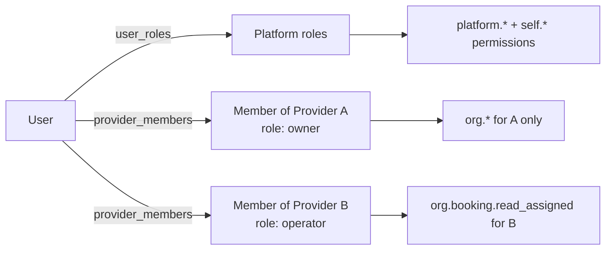

# 03 · Roles & permissions

Implementation: [`packages/domain/src/rbac/permissions.ts`](../packages/domain/src/rbac/permissions.ts) (catalog, defaults, `can()`), enforced by the global [`AuthGuard`](../apps/api/src/common/auth/auth.guard.ts) and [`PrincipalService`](../apps/api/src/common/auth/principal.service.ts).

## Model

- **Platform roles** (`roles` + `user_roles`) grant **platform** and **self** permissions. Admins can edit role permissions at runtime; the code checks *permissions*, never role names.
- **Organisation roles** (`provider_members.role`) grant **org** permissions *only for that provider*. A user may belong to several providers with different roles. Extra per-member permissions are stored in `provider_members.extra_permissions`.
- **Self** permissions apply only to resources the user owns (`ownerUserId` check).
- **Deny by default:** every route needs authentication unless marked `@Public()`. Frontend route hiding is cosmetic only.

## Required roles → implementation

| # | Brief role | Implemented as |
|---|---|---|
| 1 | Super Admin | platform role `super_admin` (all platform permissions) |
| 2 | Operations Admin | platform role `operations_admin` |
| 3 | Verification Admin | platform role `verification_admin` |
| 4 | Finance Admin | platform role `finance_admin` |
| 5 | Customer Support Admin | platform role `support_admin` |
| 6 | Provider Owner | org role `owner` |
| 7 | Provider Staff | org roles `manager`, `front_desk`, `booking_coordinator`, `accountant` |
| 8 | Service Operator / Assigned Worker | org role `operator` (sees only bookings assigned to them) |
| 9 | Traveller | platform role `traveler` (self permissions) |
| 10 | Guest | unauthenticated; public routes + guest checkout (Phase 5) |

## Platform permission matrix

✓ = granted by default.

| Permission | Super | Ops | Verification | Finance | Support |
|---|:-:|:-:|:-:|:-:|:-:|
| admin.dashboard.view | ✓ | ✓ | ✓ | ✓ | ✓ |
| provider.application.read | ✓ | ✓ | ✓ | | |
| provider.application.review | ✓ | | ✓ | | |
| provider.document.read_private | ✓ | | ✓ | | |
| provider.document.verify | ✓ | | ✓ | | |
| provider.suspend | ✓ | | ✓ | | |
| destination.manage / destination.publish | ✓ | ✓ | | | |
| category.manage | ✓ | ✓ | | | |
| listing.read_any / listing.moderate | ✓ | ✓ | ✓ | | |
| booking.read_any | ✓ | ✓ | | ✓ | ✓ |
| booking.manage_any | ✓ | ✓ | | | |
| refund.approve | ✓ | | | ✓ | |
| dispute.resolve | ✓ | | | | ✓ |
| finance.read / finance.commission.manage / finance.payout.manage | ✓ | | | ✓ | |
| user.read | ✓ | ✓ | | | ✓ |
| user.manage / user.suspend / role.manage | ✓ | | | | |
| cms.manage | ✓ | ✓ | | | |
| support.ticket.read_any / support.ticket.manage | ✓ | | | | ✓ |
| incident.manage | ✓ | ✓ | | | ✓ |
| settings.manage / feature_flag.manage | ✓ | | | | |
| audit.read | ✓ | ✓ | ✓ | ✓ | |

Separation of duties: finance cannot read KYC documents; verification cannot move money; support can resolve disputes but refunds above a configurable threshold need `refund.approve` (Phase 6).

## Organisation permission matrix

| Permission | Owner | Manager | Front desk | Booking coord. | Accountant | Operator |
|---|:-:|:-:|:-:|:-:|:-:|:-:|
| org.profile.read | ✓ | ✓ | ✓ | ✓ | ✓ | |
| org.profile.update | ✓ | ✓ | | | | |
| org.documents.manage | ✓ | ✓ | | | | |
| org.staff.manage | ✓ | | | | | |
| org.listing.read | ✓ | ✓ | ✓ | ✓ | | |
| org.listing.manage / org.listing.submit | ✓ | ✓ | | | | |
| org.inventory.manage (availability, pricing) | ✓ | ✓ | | ✓ | | |
| org.booking.read | ✓ | ✓ | ✓ | ✓ | ✓ | assigned only |
| org.booking.manage (accept, reject, complete) | ✓ | ✓ | ✓ | ✓ | | |
| org.customer_contact.read | ✓ | ✓ | ✓ | ✓ | | |
| org.finance.read | ✓ | | | | ✓ | |
| org.payout_account.manage | ✓ | | | | | |
| org.reviews.respond | ✓ | ✓ | | | | |

## Self permissions (traveller)

`self.profile.manage`, `self.booking.create`, `self.booking.read`, `self.booking.cancel`, `self.review.create`, `self.support.create` — each checked against `ownerUserId`.

## Enforcement rules

1. **Guard level** (`@RequirePermissions`) for platform/self permissions that do not depend on the target resource.
2. **Service level** (`principals.assertOrg(principal, perm, providerId)`) for every org-scoped operation, *after* loading the resource and *using the resource's own providerId* — never a providerId taken from the request body.
3. **Query level:** list endpoints for providers always add `providerId IN (caller's memberships)`; admin lists require platform permissions.
4. **Customer PII minimisation:** providers see lead guest name and contact only for their own bookings, only with `org.customer_contact.read`, and only from 72 h before the service until 7 days after (Phase 5). Licence numbers are masked except for rental operators at pickup.
5. **Audit:** every permission-gated mutation writes `audit_logs` in the same transaction.

Tests: `packages/domain/test/availability-rbac-onboarding.test.ts` (cross-tenant denial, operator scoping, separation of duties) and `apps/api/test/http-security.test.ts` (deny by default).
