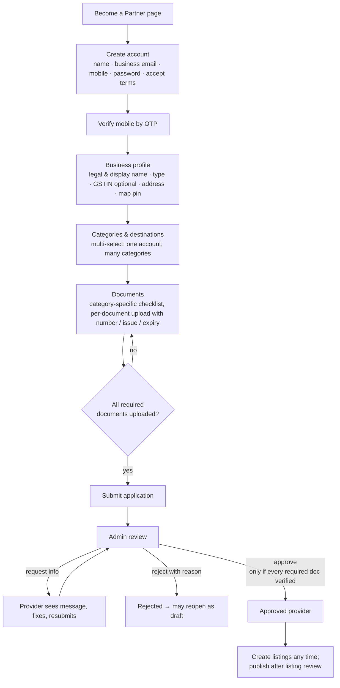
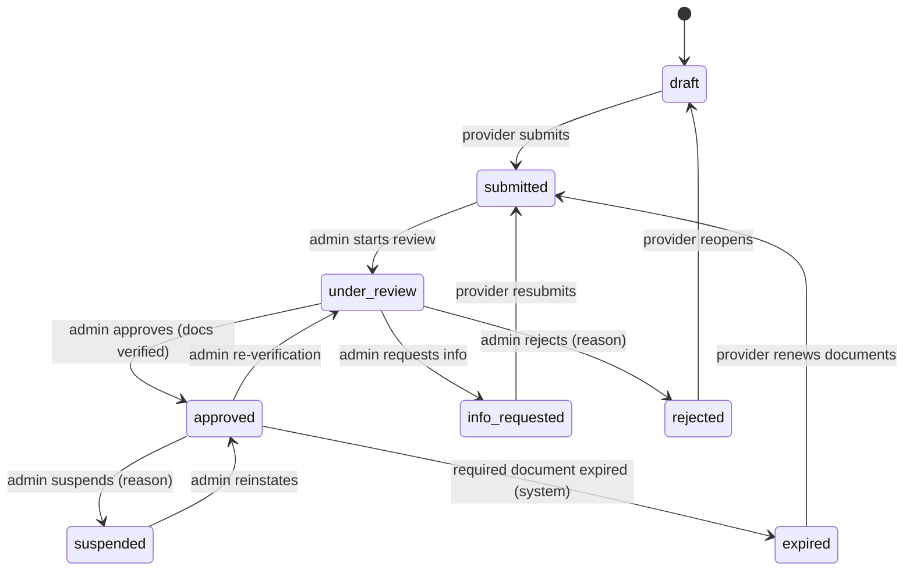

# 04 · Provider self-registration & verification

Implementation: [`packages/domain/src/onboarding/provider.ts`](../packages/domain/src/onboarding/provider.ts), [`apps/api/src/modules/provider-onboarding`](../apps/api/src/modules/provider-onboarding), [`apps/api/src/modules/admin/provider-verification.controller.ts`](../apps/api/src/modules/admin/provider-verification.controller.ts).

## Journey

Providers may prepare draft listings while the application is pending; they cannot be published until the publish gate passes.

## Provider status machine

Transitions are validated by `assertProviderTransition()` and applied with a conditional update (`WHERE status = <expected>`), so concurrent decisions cannot both apply. Every transition appends a `provider_verification_events` row (append-only, enforced by trigger) with a provider-visible `message` and an admin-only `internal_note`.

## Documents

- **Types** (`document_types`): label, subject (business, owner, boat, vehicle, property, person), whether number/expiry are required, allowed MIME types, max size.
- **Requirements** (`document_requirements`): category × document type, optionally narrowed by **state/district** for jurisdiction-specific rules. Seeded as a *starting configuration* — the verification team must confirm the applicable licences per category and jurisdiction with legal advice before launch. Nothing in code assumes identical requirements.
- **Business-level vs asset-level:** business/owner documents gate the provider; boat/vehicle/property/person documents attach to an `inventory_item` and gate *that asset's* listings.
- **Uploads** (Phase 3 implementation): client requests a pre-signed PUT to the **private** bucket → server verifies size, MIME sniffing, SHA-256 and malware scan hook → `media_assets.verified_at` set → document row created with `pending` status. Private documents are only ever served through short-lived signed GET URLs to users with `provider.document.read_private` or the owning organisation.
- **Renewal:** a new upload with `supersedes_id` marks the old document `superseded` (one current document per type/asset, enforced by a partial unique index).
- **Expiry:** daily job flags documents expiring within 30 days (notifications to provider), marks expired documents `expired`, and moves an approved provider to `expired` when a required business document lapses — which immediately makes its listings unbookable.

`evaluateDocuments()` returns `missing`, `rejected`, `expired`, `pendingReview`, `expiringSoon`, `readyToSubmit` (everything uploaded) and `fullyVerified` (everything verified and in date). Submission requires `readyToSubmit`; approval requires `fullyVerified`.

## The publish gate (critical rule)

A listing is bookable only when **all** hold (`publishBlockers()` / `isBookable()`):

| Check | Source |
|---|---|
| Provider status is `approved` | providers.status |
| Provider business documents fully verified | evaluateDocuments |
| Listing approved/published by moderation | services.status |
| Provider approved for the listing's category | provider_categories.status |
| Destination is `active` | destinations.status |
| Category enabled in that destination | destination_categories.is_enabled |
| Asset documents (boat/vehicle) verified for the inventory sold | provider_documents (asset) |

The gate is evaluated on publish **and** on every search/availability/booking request (`CatalogService.bookableServiceWhere()` on read paths), so suspensions and expiries take effect immediately without rewriting listing rows.

Approval means the platform has reviewed the submitted documents; it is **not** a certification of the provider's legal compliance. The partner agreement and public copy must say so.

## Admin verification workspace (Phase 3 UI)

Queue sorted by oldest submission (SLA), filters by status/category/district, side-by-side document viewer (signed URLs), per-document verify/reject with reason, request-info composer, internal notes, decision history, document-expiry dashboard.

## API (implemented now)

| Method | Path | Permission |
|---|---|---|
| POST | `/api/v1/provider-onboarding/applications` | authenticated user (becomes owner) |
| GET | `/api/v1/provider-onboarding/applications/{id}` | org.profile.read |
| PUT | `/api/v1/provider-onboarding/applications/{id}/business` | org.profile.update (draft / info_requested / rejected only) |
| PUT | `/api/v1/provider-onboarding/applications/{id}/scope` | org.profile.update |
| POST | `/api/v1/provider-onboarding/applications/{id}/submit` | org.profile.update |
| GET | `/api/v1/admin/provider-applications` | provider.application.read |
| POST | `/api/v1/admin/provider-applications/{id}/decision` | provider.application.review |

Next in Phase 3: document upload endpoints, staff invitations, payout account linking, notifications on each decision.
