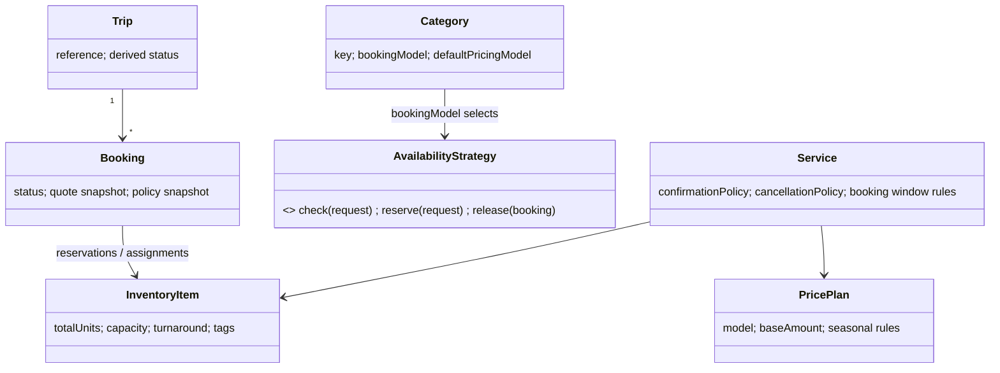
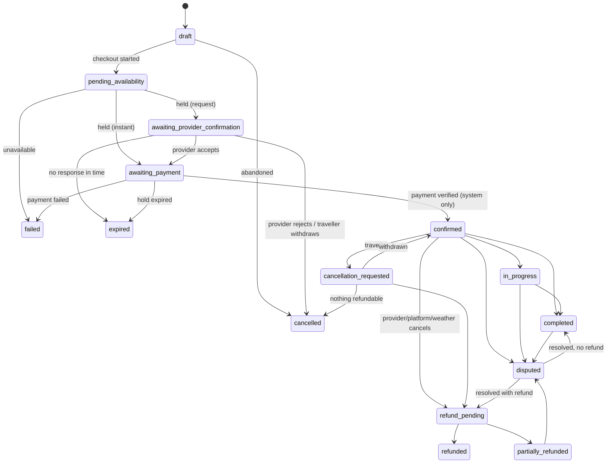

# 05 · Unified booking engine

One booking core, category-specific **strategies**. Implementation of the rules: [`packages/domain/src/booking`](../packages/domain/src/booking), [`pricing`](../packages/domain/src/pricing/engine.ts), [`availability`](../packages/domain/src/availability/strategies.ts), [`finance`](../packages/domain/src/finance). Persistence: `bookings`, `inventory_reservations`, `availability_slots`, `booking_assignments`, `payments`, `refunds`, `booking_settlements`.

## Core abstractions



| Booking model | Categories | Inventory unit | Availability check | DB guard against overselling |
|---|---|---|---|---|
| `slot_capacity` | boating, water sports, adventure, experiences, sightseeing | seats in a dated departure/session (`availability_slots`) | `slotAvailability()` — shared vs private charter, weather hold, closed | `SELECT … FOR UPDATE` on the slot; `CHECK (committed + held <= capacity)` |
| `nightly_inventory` | stays | N rooms of a room type per night | `nightlyAvailability()` — min free units across every night, day overrides, closures | lock the `inventory_item` row, count per-night reservations, insert one row per night |
| `time_range_rental` | scooty/bike, self-drive car | N vehicles of a model over a pickup→return window | `rentalAvailability()` — sweep-line max concurrency incl. turnaround buffer | lock the `inventory_item` row; count overlapping reservations |
| `assigned_trip` | taxi, auto | a specific vehicle/driver | `assignmentAvailability()` — free resource with capacity/class | `EXCLUDE USING gist (inventory_item_id =, tstzrange &&)` on `booking_assignments` |
| `assigned_person` | guides | a specific guide | as above with language tags | same exclusion constraint (+ member exclusion) |
| `package` | packages | fixed departures (slot) or on-request | slot or request flow | as slot |

All models also apply `checkBookingWindow()` (lead time, advance window, blackouts).

### Category specifics captured in `services.attributes` (validated per category)

- **Boating:** boat type, shared/private, boarding point (`service_locations` kind `boarding_point`), route, duration, safety briefing, life-jacket policy, min age, `weather_dependent = true` → operators/admins can put slots on `weather_hold` (bookings refunded in full via `initiatedBy: "weather"`).
- **Stays:** room types as inventory items (occupancy = capacity), meal plans, check-in/out times, extra-adult pricing, child policy, house rules.
- **Rentals:** vehicle model, fuel policy, km limits, refundable deposit (`deposit_per_unit`, not taxed, not commissionable), licence requirement (captured on booking, verified at pickup), pickup/return locations, inspection photos at pickup/return (Phase 5b).
- **Cabs/autos:** vehicle class, seats, trip type (local/airport/outstation), fare = base + per-km × **map-provider distance** (never invented), minimum fare, driver assignment.
- **Guides:** languages (tags), half/full day, meeting point, max group size, specialities.
- **Adventure/experiences:** sessions, participant limits, minimum age, equipment, weather dependence.

## Pricing

`buildQuote()` produces line items: base, seasonal adjustment, extra guests, coupon discount (negative), tax lines, platform fee + its tax, refundable deposit. Rules:

- Seasonal rules match by date range and weekday; highest priority wins. Stays are priced **per night**; rentals by IST pickup date.
- Tax rules are configuration per category with optional per-unit price slabs (accommodation GST depends on tariff). No rate is hard-coded.
- Coupons apply before tax; `fundedBy` decides whether provider earnings are reduced.
- The quote is **always recomputed server-side** at checkout and snapshotted on the booking (`bookings.quote`), together with the cancellation policy (`bookings.cancellation_policy`) so later edits never change agreed terms.

## Booking lifecycle



`BOOKING_TRANSITIONS` in code is the single source of truth (each transition lists allowed actors and, where relevant, the confirmation policy). Only the `system` actor can confirm a booking, and only after server-side payment verification. Each transition runs in one DB transaction that: checks `assertTransition`, updates `bookings.status` with an optimistic `version` check, appends `booking_status_history`, writes `audit_logs`, and enqueues notifications via an outbox.

**Request-to-book** (`confirmation_policy = request`): inventory is held while the provider decides (`provider_response_mins`, default 12 h); payment is requested only after acceptance, with its own short hold. No money is taken for bookings a provider might reject.

## Holds, expiry and concurrency

- A hold = `inventory_reservations` rows with `kind = hold` and `expires_at` (default 15 min for payment; provider response window for requests). Slot holds also increment `availability_slots.held`.
- On verified payment the same rows flip to `committed` (slot counters move `held → committed`).
- A BullMQ job (plus a SQL sweep as a safety net) releases expired holds and moves bookings to `expired`. Holds are also excluded by `expires_at > now()` in availability queries, so a late sweeper can never cause a false "sold out" to become an oversell.
- Concurrency: availability check + hold insert happen in one transaction under row locks (`FOR UPDATE` on the slot or inventory item, in a deterministic order by id to avoid deadlocks). CHECK and EXCLUDE constraints are the last line of defence.
- Idempotency: `POST /trips/{id}/checkout`, `/payments/verify`, refunds and webhooks require/derive an idempotency key (`idempotency_keys`, `payments.idempotency_key`, `payment_events (gateway, gateway_event_id)` unique).

## Trips and multi-service orchestration (saga)

A **trip** groups bookings from different providers. It is *not* atomic. `deriveTripStatus()` computes `planning → checkout_in_progress → awaiting_providers / action_required → confirmed / partially_confirmed → in_progress → completed / cancelled` from the components.

```mermaid
sequenceDiagram
  participant T as Traveller
  participant O as Trip orchestrator
  participant B1 as Booking: hotel (instant)
  participant B2 as Booking: boat (instant)
  participant B3 as Booking: guide (request)
  participant P as Payments
  T->>O: checkout trip
  O->>B1: hold
  O->>B2: hold
  O->>B3: hold + ask provider
  Note over O: if a hold fails → that item = failed;<br/>traveller chooses: continue without it or cancel all (release others)
  O->>P: one order for instant items (allocations per booking)
  P-->>O: captured (webhook)
  O->>B1: confirm
  O->>B2: confirm
  B3-->>O: provider accepts → payment link for B3 only
  Note over O: partial confirmations shown per item;<br/>refunds and cancellations are per booking
```

Compensation rules: a failed or rejected component never silently cancels the others; the traveller sees each item's status and decides. If a payment covered several bookings and one later fails to confirm (e.g. hold expired during a slow webhook), that booking's allocation is refunded automatically and in full.

Multi-service checkout stays behind the `multi_service_checkout` flag until each category has passed its own end-to-end tests.

## Cancellation, refunds and settlement

- `computeRefund()`: provider-chosen tiered policy (hours before start → refund %); provider/platform/weather cancellations refund 100% including fees; deposits always returned on cancellation; never refunds more than remains.
- `computeSettlement()`: commission resolved by `resolveCommissionRule()` (provider > category > destination specificity, then priority, within validity window); commission tax and withholdings (e.g. GST TCS / income-tax TDS for e-commerce operators) are **configured by finance after tax advice**; service tax is passed through to the provider or retained by the platform per category (`categories.tax_remitter`).
- Settlement rows are created on confirmation; payout eligibility is set after completion + a dispute window; refunds post negative adjustments.
- Time handling: service start instants are computed from IST dates/times with `istInstant()`; refund tiers use exact hours.
