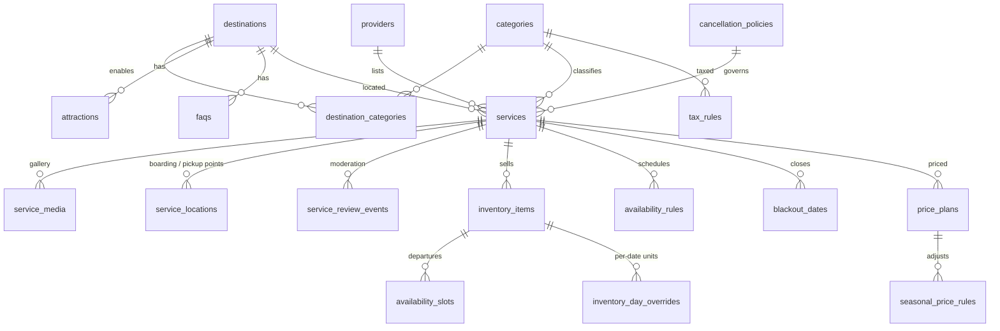
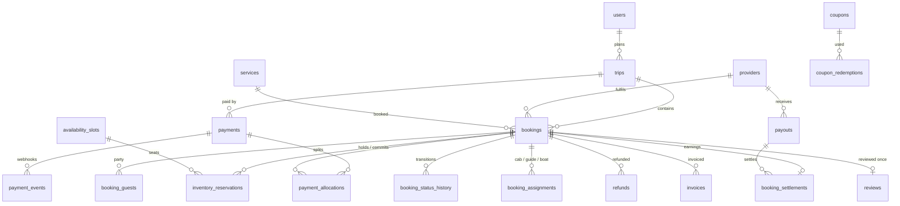

# 06 · Data model

Source of truth: [`apps/api/prisma/schema.prisma`](../apps/api/prisma/schema.prisma) (70 tables) and [`apps/api/prisma/sql/constraints.sql`](../apps/api/prisma/sql/constraints.sql). The initial migration is `prisma/migrations/20261112000000_init`.

## Conventions

| Topic | Rule |
|---|---|
| Keys | UUIDv7 primary keys (`uuid(7)`); join tables use composite PKs |
| Naming | snake_case tables/columns via `@@map`/`@map`; Prisma models in PascalCase |
| Money | `int` paise; rates `int` basis points. Per-booking amounts fit comfortably; payout aggregates are reviewed in risk R-09 |
| Time | `timestamptz(3)` for instants; `date` for IST calendar dates |
| Geo | PostGIS `geography(Point,4326)` (and `MultiPolygon` for destination boundaries) with GiST indexes; queried via raw SQL |
| JSON | Only for snapshots (quotes, policies, request), CMS blocks, and category-specific attributes validated by Zod per category |
| Demo data | `is_demo` on users, providers and services; excluded from public reads when `DEMO_DATA_ENABLED=false` (required in production) |

## Entity–relationship overview

The full ER diagram is large; these views cover each bounded context. Crow's-foot notation: `||--o{` = one-to-many.

### Identity, access and providers

```mermaid
erDiagram
  users ||--o| user_profiles : has
  users ||--o{ user_roles : holds
  roles ||--o{ user_roles : granted
  roles ||--o{ role_permissions : includes
  permissions ||--o{ role_permissions : in
  users ||--o{ sessions : "refresh sessions"
  users ||--o{ provider_members : "belongs to"
  providers ||--o{ provider_members : staff
  providers ||--o{ provider_categories : "applies for"
  categories ||--o{ provider_categories : ""
  providers ||--o{ provider_destinations : "operates in"
  destinations ||--o{ provider_destinations : ""
  providers ||--o{ provider_documents : uploads
  document_types ||--o{ provider_documents : typed
  document_types ||--o{ document_requirements : required_by
  categories ||--o{ document_requirements : requires
  inventory_items ||--o{ provider_documents : "asset docs"
  media_assets ||--o{ provider_documents : file
  providers ||--o{ provider_verification_events : history
  providers ||--o{ payout_accounts : "paid to"
```

### Marketplace, inventory and pricing

### Trips, bookings and money

### Experience and platform

`favourites`, `saved_travellers`, `emergency_contacts`, `notifications`, `notification_templates`, `push_devices`, `support_tickets` (with `incident` JSON for safety reports), `support_messages` (internal notes flagged), `audit_logs`, `cms_pages`, `banners`, `faqs`, `feature_flags`, `system_settings`, `idempotency_keys`.

## Mapping to the brief's entity list

| Brief entity | Model | Note |
|---|---|---|
| provider_staff / provider_staff_members | `provider_members` | one table with org role + extra permissions |
| provider_locations | address columns + `providers.location` + `provider_destinations` | |
| service_attributes / service_policies | `services.attributes` (validated JSON) + policy columns + `cancellation_policies` | avoids EAV tables |
| service_approvals | `service_review_events` | full moderation history |
| booking_holds / inventory_holds | `inventory_reservations (kind = hold)` | holds and commits share one table so counting is uniform |
| trip_items / booking_items | `bookings` (one per service) + `booking_guests` + quote snapshot | a trip item *is* a booking |
| payment_transactions | `payment_events` | signed webhook log |
| commissions | `commission_rules` + `booking_settlements` | |
| review_responses | `reviews.response` | one response per review |
| customer_reports | `support_tickets` (category `provider_complaint` / `safety_incident`) | |

## Invariants enforced by PostgreSQL

| Invariant | Mechanism |
|---|---|
| Slot never oversold | `CHECK (committed + held <= capacity)` |
| Cab/guide/boat not double-assigned | `EXCLUDE USING gist (inventory_item_id =, tstzrange(starts_at, ends_at) &&) WHERE released_at IS NULL` (and per staff member) |
| Amounts non-negative; discount ≤ subtotal; refunds ≤ total | CHECKs on `bookings`, `payments`, `refunds`, `price_plans`, `payouts` |
| Rates within 0–100% | CHECKs on `commission_rules`, `tax_rules`, `coupons` |
| One active owner per provider; one primary payout account | partial unique indexes |
| One current document per provider/type/asset | partial unique index `NULLS NOT DISTINCT WHERE status <> 'superseded'` |
| Webhooks processed once | `UNIQUE (gateway, gateway_event_id)` |
| Idempotent payments/refunds | unique `idempotency_key` columns |
| One review per booking; one coupon redemption per booking | unique `booking_id` |
| History cannot be rewritten | triggers forbid UPDATE/DELETE on `audit_logs`, `booking_status_history`, `provider_verification_events` |
| Published listing has a publish time | CHECK on `services` |

**Migration workflow:** `prisma migrate dev` generates SQL from the schema; Prisma does not know about the hand-written objects above, so **review every generated migration and delete any statement that drops an object defined in `constraints.sql`**. New hand-written objects go into a new migration file, never by editing an applied migration.

## Data boundaries (tenancy)

- Provider-owned rows carry `provider_id` (directly, or via `service_id`/`booking_id`). Every org-scoped API operation authorises against the resource's own `provider_id` ([03](03-roles-permissions.md)).
- Travellers see their own trips/bookings (`user_id` / `traveler_id`); providers see bookings for their services with PII minimised.
- KYC files live in the private bucket; the database stores only object keys and checksums.
- Payout bank details live with the payment gateway; only masked values and gateway references are stored.

## Soft delete, retention and archival

| Data | Policy |
|---|---|
| users | soft delete (`deleted_at`, status `deleted`) then anonymise PII after the legal retention period; bookings keep a reference |
| providers, services | soft delete; never hard-deleted while bookings/settlements reference them (FK `RESTRICT`) |
| bookings, payments, refunds, invoices, settlements | never deleted; retained per tax/accounting law (8 years assumed, confirm with finance) |
| KYC documents | retained while the provider is active + retention period; superseded files kept for audit, then purged |
| otp_verifications, sessions, idempotency_keys | purged by scheduled jobs (24 h / after expiry / 7 days) |
| audit_logs | append-only; partition by month and archive to cold storage after 24 months (Phase 9) |
| notifications | 12 months |

## Critical transactions

1. **Hold inventory** (checkout): lock slot/item rows in id order → evaluate strategy → insert reservations + bump slot `held` → booking `pending_availability → awaiting_payment|awaiting_provider_confirmation` → history + audit → commit.
2. **Confirm on payment** (webhook/verify, idempotent): lock payment row → if already captured return → mark captured → for each allocation: reservations `hold → committed` (slot `held → committed`), booking → `confirmed`, create `booking_settlements` with resolved commission → outbox notifications → commit. If a hold had already expired and capacity is gone, the booking goes `failed` and a full refund for that allocation is queued.
3. **Cancel/refund:** lock booking → `computeRefund` → create `refunds` (idempotency key) → booking `refund_pending` → release reservations → settlement adjustment → gateway refund via job → webhook settles `refunded|partially_refunded`.
4. **Provider decision:** conditional status update + verification event + audit in one transaction (implemented).
