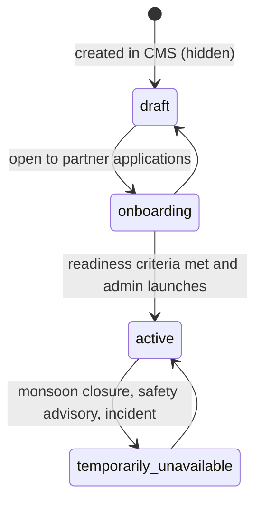

# 10 · Destination launch strategy

Destinations are data, not code. Status lives in `destinations.status` and is managed by admins with `destination.publish`.

## Lifecycle

| Status | Public site | Partners | Bookable |
|---|---|---|---|
| draft | hidden | cannot select | no |
| onboarding | "Coming soon" page with editorial content and a partner call to action | can apply and draft listings | **no** |
| active | full destination page; categories marked available only where listings exist | yes | yes (publish gate) |
| temporarily_unavailable | page with an advisory banner | yes | no new bookings; existing ones are handled case by case |

Category availability inside a destination is enabled per category (`destination_categories.is_enabled`) and shown as *available* only when the count of **bookable** listings reaches `min_verified_listings`. This is computed live from real data in `CatalogService`, so the site never claims inventory that doesn't exist.

## Readiness criteria before setting `active` (Phase 1 targets, configurable)

| Criterion | Gokarna | Murudeshwar | Karwar | Udupi |
|---|---|---|---|---|
| Verified stays (properties) | ≥ 5 | ≥ 4 | ≥ 4 | ≥ 5 |
| Boating / water activity operators | ≥ 2 | ≥ 2 | ≥ 2 | ≥ 1 |
| Two-wheeler rental businesses | ≥ 2 | ≥ 1 | ≥ 1 | ≥ 2 |
| Taxi / auto operators | ≥ 3 | ≥ 2 | ≥ 2 | ≥ 3 |
| Verified guides | ≥ 2 | ≥ 1 | ≥ 1 | ≥ 2 |
| Editorial content reviewed (overview, attractions, tips, FAQs, licensed photos) | ✓ | ✓ | ✓ | ✓ |
| Local emergency contacts and safety info verified | ✓ | ✓ | ✓ | ✓ |
| Support on-call coverage | ✓ | ✓ | ✓ | ✓ |

These numbers are starting proposals for the business team. The admin readiness view (P4) shows live counts against targets per destination.

## Rollout

1. **Phase 1, coastal launch:** Gokarna, Murudeshwar, Karwar, Udupi. They are seeded in `onboarding` with their categories enabled; onboarding drives run per town; each destination goes live independently once it is ready.
2. **Phase 2, coastal expansion:** Mangaluru, Kapu and other approved coastal towns, reusing the same playbook.
3. **Phase 3, statewide:** Bengaluru, Mysuru, Coorg, Chikkamagaluru, Hampi, Badami, Shivamogga and others. Inland categories (heritage guides, plantation stays, treks) are added through the category CMS and document requirements, not new code.

## Seasonal and safety controls

- Monsoon: admins can set a destination or category `temporarily_unavailable`, and operators can place slots on `weather_hold` (affected bookings are fully refunded).
- Advisory banners come from the CMS (`banners`, placement `destination:<slug>`).
- A launch checklist is recorded in the audit log when the status changes to `active`.
