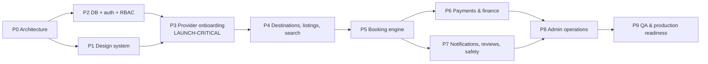

# 14 · Roadmap, dependencies & progress

## Dependency graph

External dependencies to start **now** because they have long lead times: Razorpay account and KYC, SMS DLT entity and template registration, AWS account and Mumbai region setup, a domain, legal review of terms, privacy notice and the partner agreement, tax advice on GST/TCS/TDS, and commissioned photography.

## Progress checklist

Legend: [x] done and verified · [~] implemented but not yet verified end to end · [ ] not started.

### Phase 0 — Discovery & architecture
- [x] Product requirements ([01](01-product-requirements.md))
- [x] Architecture and technology decisions, diagram, folder structure ([02](02-architecture.md))
- [x] Role and permission matrix ([03](03-roles-permissions.md))
- [x] Provider onboarding workflow ([04](04-provider-onboarding.md))
- [x] Booking lifecycle, state machine, availability strategy, saga ([05](05-booking-engine.md))
- [x] ER diagrams and schema ([06](06-data-model.md))
- [x] API specification ([07](07-api.md))
- [x] Pages and routes ([09](09-routes.md)), destination strategy ([10](10-destination-launch.md))
- [x] Hosting and deployment architecture ([11](11-deployment.md)), security checklist ([12](12-security-compliance.md)), risk register ([13](13-risk-register.md))

### Phase 1 — Design system
- [x] Tokens (colour, type, spacing, radii, shadows, motion, breakpoints), contrast-checked
- [x] Component library (30+ components) and `/design-system` showcase
- [x] Public homepage (redesigned to 11 sections with a blog section, see [FEATURES.md](FEATURES.md)), destination template (4 SSG pages), explore, 7 category landings
- [x] Traveller, partner and admin shells with distinct densities
- [x] Motion layer with reduced-motion and touch fallbacks
- [x] Production build passes; key pages screenshot-reviewed at desktop and mobile widths
- [ ] Browser QA of GSAP/Lenis interactions across devices; axe audit
- [x] Licensed photography: 16 Wikimedia Commons photos (CC0 / CC BY / CC BY-SA) with a /photo-credits page; replace with commissioned photography before launch
- [x] Type scale and spacing reduced; hero fits the first screen at 1280×720 through 1920×1080, tablet and mobile (measured)

### Phase 2 — Database & backend foundation
- [x] Prisma schema (70 tables), validated; initial migration SQL with extensions and hand-written constraints
- [x] Migration applied to PostgreSQL 17 + PostGIS 3.5 (docker-compose), including exclusion constraints, partial indexes and append-only triggers
- [x] Env validation, Prisma service (lazy connect), error envelope, Zod validation, structured logging with redaction, rate limiting, Swagger
- [x] Auth: OTP request and sign-in, sign-up, password sign-in and reset, refresh rotation with reuse detection, sign-out, `/auth/me`
- [x] RBAC: permission catalog, principal loading, global guard, org-scoped checks
- [x] HTTP security tests (9) pass without a DB
- [x] DB-backed auth flows exercised by hand against the running stack: OTP request, OTP sign-up and sign-in, `/auth/me`, rate limiting (429). Automated integration tests still to write
- [x] Reference-data seed and `admin:create` bootstrap script written
- [x] Seed executed: 50 permissions, 6 roles, 12 categories, 15 document types, 51 requirements, 4 destinations with PostGIS points; `admin:create` verified
- [x] Object storage module: `/media` endpoints with pre-signed uploads to S3, type and size checks, private documents behind short-lived links, soft delete (run against S3Mock). No upload screen in the web app yet
- [x] Shared rate limiting without Redis: counters in DynamoDB (`RATE_LIMIT_STORE=dynamodb`), run against DynamoDB Local
- [x] One-time codes in DynamoDB (`OTP_STORE=dynamodb`) with automatic expiry; PostgreSQL stays the local default
- [x] Soft delete everywhere: a partner's dropped categories and towns are marked `removed_at`, not deleted; a test guards against new hard deletes
- [ ] BullMQ / background queues

### Phase 3 — Provider self-registration & verification
- [x] Domain rules: provider status machine, document evaluation, publish gate (unit-tested)
- [x] API exercised by hand against the DB: application created with owner, scope and audit rows; submit refused without documents (422); cross-provider read/write denied (403); admin queue lists drafts; illegal approval refused (409). Automated integration tests still to write
- [x] Web: registration wizard driven end to end in a browser against the real API (fixed a bug where the review step auto-submitted)
- [ ] Document upload and verification endpoints and UI
- [x] Partner dashboard (application status, next step, required documents, services, history) and admin review page (business, owner, documents vs requirements, allowed decisions, history with internal notes)
- [ ] Document upload (unblocks submit → review → approve)
- [ ] Staff invitations; payout account linking
- [ ] Expiry job and notifications

### Phase 8 (started early) — Admin
- [x] Live admin overview figures (users, providers, applications, destinations, services, bookings, revenue) from `GET /admin/overview`
- [x] Admin → Provider applications (status tabs, review page), Destinations (launch lifecycle, readiness, featured), Listings (moderation list)
- [x] Admin → Users: search by name/email/phone, role filter, partners-only, pagination (`GET /admin/users`, `user.read`)
- [x] Admin sign-in check in the UI (signed-out → sign-in with return path; non-admin → access denied), identity + sign out
- [x] Playwright E2E: traveller OTP sign-up → blocked from admin; partner 7-step registration; signed-out redirect; super admin finds both users (10/10 consecutive green runs)

### Booking engine, marketplace and operations (built ahead of plan, demo-ready)
- [x] Booking engine for all categories (seats per departure, rooms per night, rentals by time window, cab/guide assignment); holds, instant vs request-to-book, state machine with history, settlements, refunds, hold expiry sweep. Concurrency tests against Postgres prove no overselling
- [x] Public search, listing pages, server quotes, booking panel per category, checkout with a development-only payment simulator, My Trips, cancellation with policy refunds, reviews
- [x] Partner portal: live dashboard, listings, bookings (accept/decline/start/complete/cancel), finance (commission, net, settlements, payouts)
- [x] Admin: bookings, finance, support tickets, listing moderation, document verification → approval
- [x] Demo data across every feature (docs/15-demo-data.md), all fictional and flagged is_demo
- [x] Messages: an AWS sender (Amazon SES for email, Amazon SNS for SMS, `MESSAGING_PROVIDER=aws`), built-in wording that a `notification_templates` row can replace, and notifications for booking requested / confirmed / cancelled and for partner application decisions, each recorded in `notifications`. Checked against a recording stand-in, not yet against real SES and SNS
- [ ] Real payment gateway (Razorpay), document upload screens, listing creation by partners, in-app notification list, ticket replies, multi-service checkout

### Phases 4–9
- [x] Domain engines ready ahead of time: pricing, availability strategies, booking state machine, trip status, commission, settlement, refunds (41 unit tests)
- [ ] P4 destinations/listings/search/maps · P5 booking orchestration · P6 payments · P7 notifications/reviews/safety · P8 admin ops · P9 QA and staging

## Definition-of-done tracker (brief §27)

| Criterion | State |
|---|---|
| Traveller can register and manage an account | API built (needs DB verification); account screens P7 |
| Provider can independently register | wizard + API wired; needs DB verification |
| Provider can submit required documents | P3 (uploads not built) |
| Admins can review and approve providers | API built; UI P3 |
| Approved providers can create listings; admins publish them | P3–P4 |
| Travellers search the four launch destinations; view real listings and availability | P4–P5 |
| Category-specific availability works correctly | rules built and unit-tested; persistence P5 |
| Booking and payment flow; confirmations | P5–P6 |
| Providers manage bookings; travellers manage trips | P5 |
| Admins monitor the marketplace | P8 |
| Refund and cancellation rules work | rules built and unit-tested; flows P6 |
| Commission and payout calculations correct | rules built and unit-tested; payouts P6 |
| Permissions and data isolation enforced | verified by hand against the DB (cross-provider 403, admin-only routes 403 for partners); automated tests pending |
| Core workflows have automated tests | unit + HTTP; E2E pending |
| Verified staging deployment | not started |
| Production deployment documentation and operational checks | documented ([11](11-deployment.md)); not executed |

## Testing strategy

| Layer | Tool | Scope | Status |
|---|---|---|---|
| Domain unit | Vitest | pricing, availability, state machines, commission, refunds, RBAC, onboarding | 41 passing |
| API HTTP | Vitest + real Nest app | auth guard, validation, error envelope, readiness | 9 passing |
| API integration | Vitest + Postgres (docker-compose or Testcontainers) | onboarding, verification, inventory holds under concurrency, booking transitions, payment webhook idempotency, refunds, payouts, cross-tenant denial | pending a DB |
| E2E | Playwright | registration, sign-in, admin access control, admin Users view (now); booking journeys from brief §22 (P5+) | 4 passing |
| Accessibility | axe-core in Playwright | all public and app pages | P9 |
| Performance | Lighthouse CI budgets | public pages on mobile | P9 |

## Immediate next steps

1. Add DB-backed integration tests for auth, onboarding and admin decisions (including cross-provider access denial).
2. Phase 3: storage module and document uploads, partner application page, admin KYC workspace.
